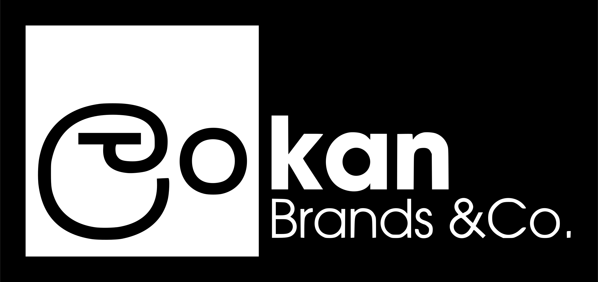

<p align="center">
  
</p>

<h3 align="center">For small businesses building something of their own</h3>
<p align="center"><strong>Your business. Your style.</strong></p>

<p align="center">
  Astro 5 · Tailwind CSS 4 · TypeScript · GitHub Pages
</p>

---

The website for **Lankan Brands & Co.**, a boutique branding and digital marketing studio for small businesses and founders. It's a fully static, multi-page site with a deliberately simple look: light pages, big thin uppercase titles, generous whitespace, and the work at the centre.

## ✦ Highlights

- **Simple pages.** Home, About, Work, Services and Contact, each short and focused, with the same top menu and a "Start a project" pill.
- **Work archive.** Category filter tabs, a three-column photo grid with title, date and category tag, and a hover "View project" overlay. Each project gets its own page with a full-width cover and a gallery. Adding a project means adding a folder of photos and one entry; see [Adding a project](#-adding-a-project).
- **The real logo, as vectors.** The supplied artwork was traced 1:1 into SVG paths (`src/data/logo-paths.json`). The `Logo` component draws it dark on light pages and light in the black footer.
- **Quiet motion.** Gentle fade-ins as sections scroll into view, plus hover states. Everything switches off under `prefers-reduced-motion`.
- **Contact that works.** A Web3Forms contact form (with a no-JavaScript fallback), WhatsApp click-to-chat, a floating WhatsApp button, and call and email links.
- **Accessible by default.** Skip link, semantic landmarks, visible focus rings, an accessible mobile menu, and live form errors.
- **Progressive enhancement.** All content is server-rendered HTML. If JavaScript fails, nothing is hidden, and the Work filters simply show every project.
- **SEO ready.** Per-page titles and descriptions, canonical URLs, Open Graph and Twitter cards, JSON-LD (`ProfessionalService`, plus `FAQPage` on Services), a sitemap and `robots.txt`, all base-path aware.
- **Optimised images.** Every photo is emitted as AVIF and WebP with a responsive `srcset`.
- **Zero-config deploy.** One GitHub Actions workflow works for user sites, project sites and custom domains.

## ✦ Quick start

Requires **Node 20.3+** (22 recommended).

```bash
npm install
npm run dev        # http://localhost:4321
npm run build      # type-check + static build → dist/
npm run preview    # serve dist/ locally
```

## ✦ Project structure

```text
.
├── .github/workflows/deploy.yml   # GitHub Pages CI/CD
├── public/
│   ├── brand/                     # Logo files to share (SVG + PNG)
│   ├── invoice/                   # Invoice Studio (standalone, private)
│   ├── favicon.svg · apple-touch-icon.png · icon-512.png
│   └── og-image.png               # 1200×630 social card
├── scripts/brand-assets.mjs       # Regenerates public/brand, icons and the OG image
└── src/
    ├── assets/makers/             # "Who we're for" stock photos (Pexels) + CREDITS.md
    ├── assets/projects/<slug>/    # Project photos: cover.jpg + gallery (01.jpg, 02.jpg…)
    ├── components/
    │   ├── islands/ContactForm.tsx  # Web3Forms contact form (React, client:visible)
    │   ├── sections/              # Header, Footer
    │   └── ui/                    # Logo, ProjectCard, MakersGrid, CtaBand, WhatsApp button/icon
    ├── data/
    │   ├── site.ts                # ← COPY & CONTACT: services, values, process, FAQ, email, phone, socials
    │   ├── projects.ts            # ← WORK: one entry per project
    │   ├── paths.ts               # base-path-aware href()
    │   └── logo-paths.json        # Traced logo vectors (single source of truth)
    ├── layouts/BaseLayout.astro   # <head>, SEO, header, footer, WhatsApp button, scripts
    ├── pages/                     # index, about, work/, work/[slug], services, contact, thanks, 404, robots.txt
    ├── scripts/                   # header/menu, fade-in reveal
    └── styles/global.css          # Tailwind 4 theme tokens + components
```

## ✦ Design system

Tokens live in `src/styles/global.css` under `@theme` and are available as Tailwind utilities.

| Token | Value | Use |
| --- | --- | --- |
| `paper` | `#F4F4F2` | Page background |
| `card` | `#FFFFFF` | Raised surfaces |
| `ink` | `#111111` | Text, primary buttons, footer |
| `muted` | `#6B6B6B` | Secondary text |
| `line` | `#DEDEDE` | Borders & dividers |
| `accent` | `#2563EB` | Focus rings only |

**Type:** DM Sans Variable (self-hosted), a geometric sans that matches the letterforms in the artwork. The building blocks are:

| Class | Look | Used for |
| --- | --- | --- |
| `.page-title` | Big, thin (300) uppercase | "WORK", "SERVICES" |
| `.label` | Small, bold, tracked uppercase | Menu, section labels |
| `.meta` | Monospace uppercase | Dates and numbers |
| `.tag` | Outlined | Category tags |

Buttons are `.btn` combined with `.btn-primary` (black pill) or `.btn-ghost` (outlined).

## ✦ Editing content

Site copy is in **`src/data/site.ts`**: the tagline, services, values, process steps, FAQ, email, phone, location and social links. Social profiles (`site.social`: label, icon, handle, URL) appear with icons in the footer and on the Contact page, and are listed as `sameAs` in the structured data. Links with an empty `href` are hidden. Icons are in `src/components/ui/SocialIcon.astro`: Facebook, Instagram and Threads come from Simple Icons (CC0), and LinkedIn comes from Lucide (ISC).

## ✦ Adding a project

1. Create a folder `src/assets/projects/<slug>/`, using lowercase words joined by hyphens, for example `kiri-bakehouse-rebrand`.
2. Put the photos in it (JPG, PNG or WebP, about 2000px wide). Name the main photo `cover.jpg`. Every other photo becomes the gallery, in file-name order (`01.jpg`, `02.jpg`, …).
3. Add an entry to `src/data/projects.ts` with the same `slug`, plus a title, date (`YYYY-MM-DD`), category, a one- or two-sentence summary and a short description of the cover photo. Set `featured: true` to show it on the homepage.

The Work grid, the filter tabs (one per category), the project page and the homepage's "Selected work" all appear automatically. Until the first project is added, the Work page shows a short "coming soon" note.

> The "Who we're for" photos are illustrative Pexels stock photos, not client work. Keep them out of the Work pages.

## ✦ Contact details

Email and phone live in `site.email` and `site.phone` in `src/data/site.ts`. The phone has three forms: `display` for the visible text, `e164` for `tel:` links, and `whatsapp` for `wa.me` links. One number powers all of these:
- the Contact page
- the footer
- the mobile menu
- the "Let's build something" band at the foot of each page
- the floating WhatsApp button (bottom-right; the footer leaves room for it)
- the JSON-LD contact point

## ✦ Contact form

The Contact page's form emails every enquiry through [Web3Forms](https://web3forms.com) to the inbox linked to the access key. Change the recipient in the Web3Forms dashboard; no code change is needed.

- **Fields:** name and email (required), services (optional), and project details (required, 10–3000 characters).
- **With JavaScript:** inline validation, JSON submit, a success panel, and on failure a retry plus pre-filled email and WhatsApp fallbacks so no enquiry is lost.
- **Without JavaScript:** it posts as a normal HTML form, and Web3Forms redirects back to `/thanks/`.
- **Spam:** filtered by Web3Forms' `botcheck` honeypot.
- **Email:** the subject is "New enquiry from {name}", and replies go straight to the visitor's email.

Locally, copy `.env.example` to `.env`. On GitHub, add them under **Settings → Secrets and variables → Actions → Variables**.

| Variable | Default | Purpose |
| --- | --- | --- |
| `PUBLIC_CONTACT_EMAIL` | `lankanbrands.co@gmail.com` | Footer, Contact section, discovery-call & email-fallback links |
| `PUBLIC_WEB3FORMS_KEY` | the Lankan Brands & Co. key | Web3Forms access key for the contact form |
| `SITE_URL` | set by CI | Absolute origin for canonical / OG URLs |
| `BASE_PATH` | set by CI | `/` or `/<repo-name>` |

## ✦ Deploying to GitHub Pages

1. Push this project to a GitHub repository (default branch `main`).
2. In the repo, go to **Settings → Pages** and set **Source** to **GitHub Actions**.
3. Push to `main` (or run the workflow manually from the **Actions** tab).

That's it — `.github/workflows/deploy.yml` reads your Pages configuration and sets `SITE_URL` and `BASE_PATH` for you:

| Repository | Live URL | `BASE_PATH` |
| --- | --- | --- |
| `<user>.github.io` | `https://<user>.github.io/` | `/` |
| `lankan-brands` | `https://<user>.github.io/lankan-brands/` | `/lankan-brands` |
| any + custom domain | `https://lankanbrands.com/` | `/` |

**Custom domain:** add it under Settings → Pages → Custom domain (and create a `CNAME` DNS record pointing to `<user>.github.io`). The workflow picks up the new origin automatically on the next run.

**Building for Pages manually:**

```bash
SITE_URL=https://<user>.github.io BASE_PATH=/lankan-brands npm run build
```

## ✦ Invoice Studio

An internal invoicing tool ships with the site at **`/invoice/`** (for example `https://lankan-co.github.io/invoice/`). It is a single self-contained file, `public/invoice/index.html`, that Astro copies to the build as is.

- **Documents:** invoices, quotations and receipts with line items, discounts, tax, part payments, a QR code, amount in words and signatures. Downloads as A4 PDFs (long documents split across pages), and also prints and shares to WhatsApp or email.
- **Tracking:** an overview of billed, collected, outstanding and overdue amounts, plus saved clients and a price list of the studio's services.
- **On brand:** the traced logo vectors are built in, so they always appear in PDFs. The default **Studio** template uses the black header with the artwork's vertical bands and the original white lockup. Light templates use a reversed (ink) lockup. Type is DM Sans with the site's monochrome palette, and there are light and dark themes.
- **Defaults:** amounts in Sri Lankan rupees (Rs.), numbering `LB-INV-2026-0001` / `LB-QUO-…` / `LB-RCT-…`, and studio payment terms. Everything is editable under **Settings**.
- **Data:** everything is stored in the browser (`localStorage`) only. Use **Settings → Export backup** regularly, and import it to move to another device.
- **Private:** `noindex`, left out of the sitemap, and disallowed in `robots.txt`.

If the logo vectors in `src/data/logo-paths.json` ever change, update the `LOGO` constant near the top of the invoice script too.

## ✦ Brand assets

`npm run brand` regenerates the logo SVGs/PNG, favicons, the Open Graph image from `src/data/logo-paths.json`. Use the files in `public/brand/` anywhere you need the logo — they're also publicly served at `/brand/…`.

## ✦ Accessibility & motion notes

- The mobile menu closes on <kbd>Esc</kbd>, returns focus to its button and is `inert` while hidden.
- Project hover overlays also appear on keyboard focus. Work filters are real buttons with `aria-pressed`.
- `prefers-reduced-motion: reduce` turns off the fade-ins, smooth scrolling and the WhatsApp button's hover scale.

---

<p align="center"><sub>© Lankan Brands & Co. — Your business. Your style.</sub></p>
