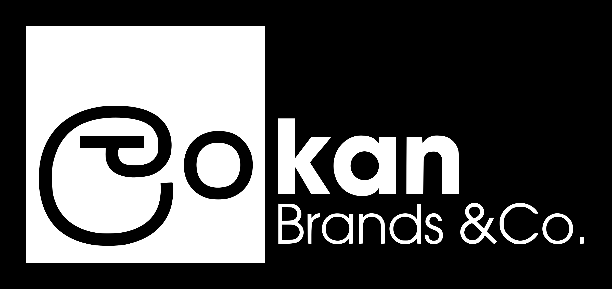

<p align="center">
  
</p>

<h3 align="center">For small businesses building something of their own</h3>
<p align="center"><strong>Your business. Your style.</strong></p>

<p align="center">
  Astro 5 · Tailwind CSS 4 · React islands · Framer Motion · TypeScript · GitHub Pages
</p>

---

The website for **Cokan Brands & Co.** — a boutique branding and digital marketing studio for small businesses and founders. It's a fully static, single-page site designed to be a demonstration of the craft it sells: minimal, confident, quietly animated and fast.

| Lighthouse (local, uncompressed preview) | Performance | Accessibility | Best Practices | SEO |
| --- | :-: | :-: | :-: | :-: |
| Desktop | 100 | 100 | 100 | 100 |
| Mobile | 98 | 100 | 100 | 100 |

## ✦ Highlights

- **The real logo, as vectors.** The supplied artwork was traced 1:1 into SVG paths (`src/data/logo-paths.json`) — crisp at any size, and animatable piece by piece.
- **Animated brand entrance.** The white square settles, the “Co” mark unfurls from the centre of its spiral, and the wordmark slides out from behind it.
- **Restrained motion.** Scroll reveals (fade-up + un-blur), staggered groups, a scroll-linked process line, gentle hero parallax, hover blooms, a cursor-following glow, magnetic CTAs and Lenis smooth scrolling.
- **Accessible by default.** Skip link, semantic landmarks, visible focus rings, keyboard-reachable hover content, accessible mobile menu, live form errors, and **every animation switches off under `prefers-reduced-motion`**.
- **Progressive enhancement.** All content is server-rendered HTML. If JavaScript fails, nothing is hidden.
- **SEO ready.** Meta, canonical, Open Graph + Twitter cards, JSON-LD (`ProfessionalService`), sitemap and robots.txt — all base-path aware.
- **Optimised images.** Case-study covers are emitted as AVIF + WebP with responsive `srcset`.
- **Zero-config deploy.** One GitHub Actions workflow works for user sites, project sites and custom domains.

## ✦ Quick start

Requires **Node 20.3+** (22 recommended).

```bash
npm install
npm run dev        # http://localhost:4321
npm run build      # type-check + static build → dist/
npm run preview    # serve dist/ locally
```

## ✦ Project structure

```text
.
├── .github/workflows/deploy.yml   # GitHub Pages CI/CD
├── public/
│   ├── brand/                     # Logo files to share (SVG + PNG)
│   │   ├── cokan-logo.svg         #   full logo
│   │   ├── cokan-logo-tagline.svg #   logo + tagline lockup
│   │   ├── cokan-mark.svg         #   logo-only mark
│   │   └── cokan-logo.png
│   ├── favicon.svg · apple-touch-icon.png · icon-512.png
│   └── og-image.png               # 1200×630 social card
├── scripts/brand-assets.mjs       # Regenerates everything in public/brand, icons, OG image, covers
└── src/
    ├── assets/work/               # Case-study images (→ AVIF/WebP at build)
    ├── components/
    │   ├── islands/               # React + Framer Motion (hydrated only where needed)
    │   │   ├── HeroLogo.tsx       #   animated logo entrance        client:load
    │   │   ├── Magnetic.tsx       #   magnetic CTA wrapper          client:idle
    │   │   ├── CursorGlow.tsx     #   soft pointer glow             client:idle
    │   │   └── ContactForm.tsx    #   validated contact form        client:visible
    │   ├── sections/              # Header, Hero, Philosophy, Services, Process, Work,
    │   │                          # Testimonials, Contact, Footer (static Astro)
    │   └── ui/                    # Logo, SectionHeading
    ├── data/
    │   ├── site.ts                # ← ALL COPY: services, process, work, testimonials, socials
    │   └── logo-paths.json        # Traced logo vectors (single source of truth)
    ├── layouts/BaseLayout.astro   # <head>, SEO, global scripts
    ├── pages/                     # index, 404, robots.txt
    ├── scripts/                   # Vanilla TS: reveals & scroll effects (Framer Motion DOM API),
    │                              # Lenis smooth scroll, header/menu
    └── styles/global.css          # Tailwind 4 theme tokens + components
```

## ✦ Design system

Tokens live in `src/styles/global.css` under `@theme` and are available as Tailwind utilities.

| Token | Value | Use |
| --- | --- | --- |
| `ink` | `#000000` | Primary background |
| `card` / `card-2` | `#0A0A0A` / `#111111` | Cards, raised surfaces, background bands |
| `paper` | `#FFFFFF` | Primary text, primary buttons |
| `muted` | `#A3A3A3` | Secondary text |
| `soft` | `#F5F5F5` | Warm off-white hover |
| `accent` | `#60A5FA` | Used sparingly — focus rings, one case-study highlight |
| `line` | `#1F1F1F` | Borders & dividers |

**Type:** DM Sans Variable (self-hosted) — a geometric sans that matches the letterforms in the supplied artwork. Large headlines use tight negative tracking. Swap `--font-sans` / `--font-display` to use Inter, Geist or Satoshi instead.

**Texture:** The vertical bands from the artwork are recreated as `.bg-bands`; `.bg-grain` adds a subtle film grain.

## ✦ Editing content

Everything you'll want to change is in **`src/data/site.ts`** — tagline, services, process steps, values, case studies, testimonials, email and social links. Social links with an empty `href` are hidden.

> ⚠️ **Case studies and testimonials are placeholders, so their sections are currently hidden.** Replace them with real clients in `site.ts`, then re-add `<Work />` and `<Testimonials />` (and the `Work` nav link) in `src/pages/index.astro`. Drop real photos into `src/assets/work/` (JPG/PNG at ~1600px wide) and point each case study's `image` at the new file — Astro generates AVIF/WebP and responsive sizes automatically.

## ✦ Contact form

The site is static, so the form works in two modes:

1. **No setup (default):** submitting opens the visitor's email app with their message pre-filled, addressed to `PUBLIC_CONTACT_EMAIL`.
2. **Form service:** set `PUBLIC_FORM_ENDPOINT` to a JSON-accepting endpoint (e.g. [Formspree](https://formspree.io), Basin, Getform) and messages are posted directly with an inline success state.

Locally, copy `.env.example` to `.env`. On GitHub, add them under **Settings → Secrets and variables → Actions → Variables**.

| Variable | Default | Purpose |
| --- | --- | --- |
| `PUBLIC_CONTACT_EMAIL` | `hello@cokanbrands.com` | Email fallback, footer & discovery-call link |
| `PUBLIC_FORM_ENDPOINT` | *(empty)* | Form POST URL |
| `SITE_URL` | set by CI | Absolute origin for canonical / OG URLs |
| `BASE_PATH` | set by CI | `/` or `/<repo-name>` |

## ✦ Deploying to GitHub Pages

1. Push this project to a GitHub repository (default branch `main`).
2. In the repo, go to **Settings → Pages** and set **Source** to **GitHub Actions**.
3. Push to `main` (or run the workflow manually from the **Actions** tab).

That's it — `.github/workflows/deploy.yml` reads your Pages configuration and sets `SITE_URL` and `BASE_PATH` for you:

| Repository | Live URL | `BASE_PATH` |
| --- | --- | --- |
| `<user>.github.io` | `https://<user>.github.io/` | `/` |
| `cokan-brands` | `https://<user>.github.io/cokan-brands/` | `/cokan-brands` |
| any + custom domain | `https://cokanbrands.com/` | `/` |

**Custom domain:** add it under Settings → Pages → Custom domain (and create a `CNAME` DNS record pointing to `<user>.github.io`). The workflow picks up the new origin automatically on the next run.

**Building for Pages manually:**

```bash
SITE_URL=https://<user>.github.io BASE_PATH=/cokan-brands npm run build
```

## ✦ Brand assets

`npm run brand` regenerates the logo SVGs/PNG, favicons, the Open Graph image and the placeholder case-study covers from `src/data/logo-paths.json`. Use the files in `public/brand/` anywhere you need the logo — they're also publicly served at `/brand/…`.

## ✦ Accessibility & motion notes

- All hover-only details (service descriptions) also open on keyboard focus, and are always visible on touch screens.
- The mobile menu closes on <kbd>Esc</kbd>, returns focus to its button and is `inert` while hidden.
- `prefers-reduced-motion: reduce` disables reveals, parallax, the logo animation, the cursor glow, magnetic buttons and Lenis.

---

<p align="center"><sub>© Cokan Brands & Co. — Your business. Your style.</sub></p>
